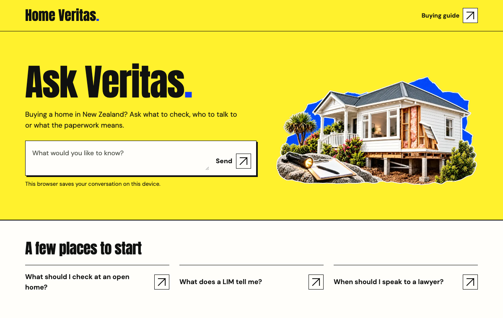
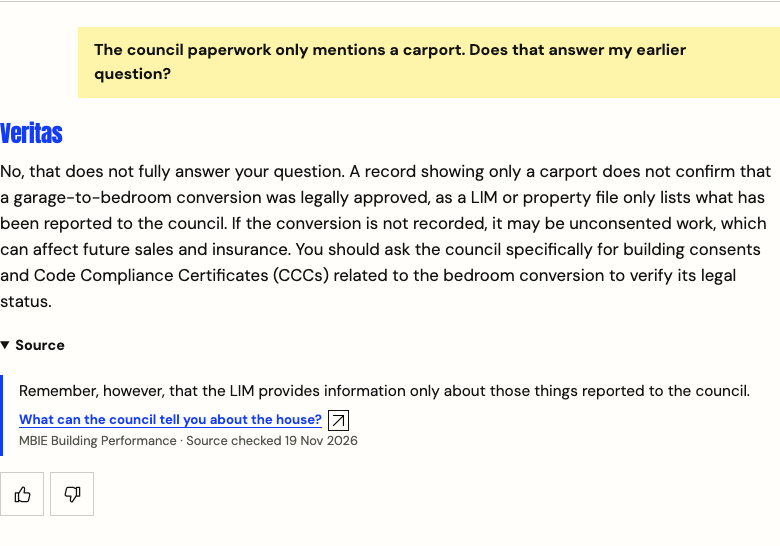

# Ask Veritas

Ask Veritas helps people buying a home in New Zealand. Ask what to look for at a viewing, open the passage behind the answer, then come back when the agent sends the paperwork.

[](docs/ask-veritas.png)

## Try it locally

Use Node.js 24 or 26, npm and an Ollama chat model with JSON output. Start Ollama, then run these commands.

```sh
git clone https://github.com/rafamarins/veritas-agent.git
cd veritas-agent
npm ci
npm run model:local
npm run dev
```

Open [Ask Veritas on localhost](http://127.0.0.1:8794). The setup command lists your installed models and saves your choice in the ignored file `worker/.dev.vars`. Kev is optional for chat. You can also skip model setup to explore the indexed excerpts. Local development needs no Cloudflare account.

### Try a follow-up

> I saw a garage converted into a bedroom at an open home. Which council records should I ask for?

Open the source under the reply. The quotation links to the publisher and shows its check date. Reload the page and ask this follow-up.

> The council paperwork only mentions a carport. Does that answer my earlier question?

Veritas can refer back to what you saw and suggest which records to ask for. The thumbs below each answer mark it helpful or unhelpful. Click the same thumb again to remove your vote.

<details>
<summary>See the follow-up in the local browser test</summary>



</details>

## The guide and its sources

The app uses the Home Veritas artwork, fonts and boxed arrow. Its 52 topic cards and 82 detailed questions cover the buying process. The questions also have Brazilian Portuguese, Spanish and Simplified Chinese versions. [Read the buying guide](https://rafael.co.nz/outros/home-veritas/)

The [catalogue](sources/references.json) covers all 48 references in the guide. A clean checkout includes short, verified quotations from 44 publisher pages and links to four lookup tools. A buyer can use the Auckland Flood Viewer to look up their own address. The chat cannot see that search.

These commands add searchable passages from the publishers.

```sh
npx playwright install chromium
npm run references:refresh
```

The indexer checks each page for its reviewed excerpt before accepting more text. If wording changes or a publisher blocks the fetch, it keeps the last verified text and date. The expanded index stays outside Git. The Worker searches the index when a buyer asks a question.

## What lives where

| | What it keeps |
| --- | --- |
| Buyer's browser | The last 30 exchanges, citations, anonymous answer receipts and selected thumbs. Clear chat clears this device's conversation. |
| Worker request | The question and up to eight relevant earlier turns for this reply. Buyer messages and replies do not go into the server database. |
| Cloudflare Durable Object | A random receipt per answer, its public guide topic, answer mode, UTC day and current vote. A receipt identifies one answer. There is no buyer or conversation ID. The daily job removes receipts older than 30 days. |
| Daily review | Copies of generated answers to public guide questions, source IDs, Kev scores and the decision for each topic. Active answer styles stay available for later requests. |

On localhost, Wrangler emulates Cloudflare storage and Ollama answers on the machine. On Cloudflare, Workers AI runs Llama 3.3 70B. Pages serves this one page and calls the Worker through a service binding. The browser only calls its own origin.

## Daily review with Kev

At 04:17 UTC a Workers Cron Trigger reviews up to two public guide questions. It starts with topics that received thumbs down or produced source-only answers in the past week. A rotating guide question keeps the review active on quiet days. Each vote can be changed or removed for 30 days.

The Worker answers each public question with two fixed styles. One gives the usual answer. The other starts with what a source establishes. It checks the quotations, then sends each answer and its cited passages to [Jared Palmer's Kev](https://github.com/jaredpalmer/kev). Kev scores source support and usefulness independently through its System One API.

The alternate style needs at least 0.85 for support and 0.75 for usefulness. When both answers can be scored, neither score may fall and their combined improvement must reach 0.15. These are initial thresholds for this project. If neither answer meets both thresholds, the run flags the topic for review. A failed judge run keeps the current style. Votes can move a question up the review list. They cannot rewrite prompts or edit guidance.

To try a review, start a local Kev server using the [upstream setup](https://github.com/jaredpalmer/kev#run-it-locally). Enter its loopback URL when running `npm run model:local`, or set `KEV_URL` in the ignored `worker/.dev.vars`. Restart the dev server, then run `npm run review:local`. Wrangler dispatches the real cron handler to the local Worker. Repeating a completed day skips the model calls.

For a future deployment, provide an operator-controlled HTTPS Kev endpoint through the Worker's `KEV_URL` secret and `KEV_TOKEN` if the endpoint requires it. Kev receives only public review examples.

## Chat safeguards

The chat can retrieve passages and write a vote. It cannot run commands, browse buyer-supplied URLs or send messages. The model treats questions, earlier replies and source text as data. The Worker accepts known citation IDs, checks direct quotations and supplies links from the index. The page renders replies as text. If inference or validation fails, it labels the excerpts it can show.

The Worker checks the request origin, JSON size, history length and question length before inference. The edge binding allows 12 requests per client per minute for each route and location. A shared daily limit caps accepted chat requests at 200. The public Worker URL and preview URLs are disabled. Cloudflare's network DDoS protection applies on deployment. The local suite checks the request limits and how the app responds when Cloudflare denies a request. [Rate limiting](https://developers.cloudflare.com/workers/runtime-apis/bindings/rate-limit/) · [DDoS protection](https://developers.cloudflare.com/ddos-protection/)

## Checks and project files

```sh
npm test
npm run build
npx playwright install chromium webkit
npm run test:journey
npm run test:journey -- --webkit
npm run eval:setup
npm run eval
```

The build compiles both Cloudflare bundles locally. The browser journeys and three Promptfoo samples need the running app with a local chat model. The samples cover a cited answer, a viewing follow-up and a request outside the agent's role. Eval setup installs a separate locked Promptfoo toolchain and skips optional peer dependencies. The eval command disables sharing, telemetry, caching and saved reports.

| File | What to look for |
| --- | --- |
| [Project prompt history](PROMPTS.md) | Rafael's prompts for this assignment |
| [Chat prompt and output checks](src/assistant.js) | Worker AI binding, local model and citation validation |
| [Retrieval](src/retrieval.js) | How the guide, the index and previous turns inform an answer |
| [Browser chat](pages/public/app.js) and [device history](pages/public/history.js) | Follow-ups, votes and clearing a conversation |
| [HTTP handler](src/http.js) and [shared storage](src/quality-store.js) | Input limits, receipts, votes and the daily budget |
| [Daily review](src/review.js) and [sample evals](evals/promptfooconfig.yaml) | Kev decisions and reproducible checks |
| [Worker configuration](worker/wrangler.jsonc) and [Pages configuration](pages/wrangler.jsonc) | Llama, Durable Objects, rate limiting, cron and service binding |

[Contributor instructions](AGENTS.md) · [Verification skill](.agents/skills/verify-veritas/SKILL.md)
